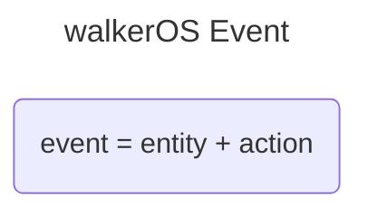

# Event model

The walkerOS event model was created to support analytics, marketing, privacy
and data science needs.

## Entity-action approach

The walkerOS event model is built on the entity-action approach, which
captures user interactions in a structured, flexible way. Two components
define each event:

* the **'entity'** (what is involved within an interaction) and
* the **'action'** (what is done with the entity)

walkerOS event definitions are fully flexible: build your tracking around
your business logic, instead of forcing your business logic into analytics
specs.

Tracking terms should be plain enough that everyone involved understands them
immediately. Only when everyone understands what is being measured are there
fewer misunderstandings, higher data quality, and more actionable data across
the organization.

## Event structure

A walkerOS event consists of three components:

* a **trigger** (e.g. load)
* an **entity** (e.g. page)
* an **action** (e.g. view)

This example shows the structure and components of a walkerOS event. Keys are
static, their content can be defined dynamically with different value types.

<CodeSnippet
  code={`
{
  name: 'promotion visible', // Name as a combination of entity and action
  data: {
    // Arbitrary properties related to the entity
    name: 'Setting up tracking easily',
    interactive: false,
  },
  context: {
    // Provides additional information about the state during the event
    stage: ['learning', 1], // A logical funnel stage
    test: ['engagement', 0], // Key, [value, order]
  },
  globals: {
    // General properties that apply to every event
    language: 'en',
  },
  custom: {}, // Additional space for individual setups
  user: {
    // Contains user identifiers for different identification levels
    // Need consent; the session source can set session and device, you set id
    id: 'us3r1d',
    device: 'c00k131d',
    session: 's3ss10n1d',
    // More user-related properties, see below
  },
  nested: [
    // All nested entities within the main entity
    { entity: 'github', data: { repo: 'walkerOS' } },
  ],
  consent: {
    // Status of the granted consent state(s)
    functional: true,
    marketing: true
  },
  id: '0123456789abcdef', // W3C Trace Context span_id (16 lowercase hex chars)
  trigger: 'visible', // Name of the trigger that fired
  entity: 'promotion', // The entity name involved in the event
  action: 'visible', // The specific action performed on the entity
  timestamp: 1647261462000, // Time when the event fired
  timing: 3.14, // Seconds from the start of the run until the event fired
  source: {
    // Details about the origin of the event
    type: 'browser', // Source kind (e.g. browser, dataLayer, session)
    platform: 'web', // Runtime platform (web or server)
    schema: '4', // walkerOS event schema version
    trace: '0123456789abcdef0123456789abcdef', // run-scoped W3C trace_id (groups all events of a run)
    count: 1, // emission sequence within the run
    release: { web: '3' }, // per-flow config release map, accumulates web to server (a bundle defaults to a content id of its config, packages and CLI version)
    url: 'https://github.com/elbwalker/walkerOS', // Page or request URL
    referrer: 'https://www.walkeros.io/', // Referrer URL
  },
}

`}
  language="javascript"
/>

Event names are a combination of the entities involved (*promotion*) and the
action performed (*visible*).

The structure is the same for every interaction, whether the event is a
`page view`, `session start`, `product visible`, or `order complete`.

### Data properties

Data properties describe the entity in more detail. Depending on the entity
(e.g. *product*, *order*, *content*) they can vary and provide specific insights
relevant to the interaction.

### Context

Context is the state or environment in which the event was
triggered. It could be as simple as a page position or as complex as the logical
stage in a user journey, like a shopping journey from inspiration to checkout
stage.

### Globals

Globals describe the overall state influencing events or user behavior.
These might include the theme used, page type for web, or cart value.

### Custom

A reserved space for the custom requirements of individual setups, within the
defined structure.

### User

There are recommended identifiers used for stitching user journeys together:
`id`, `device`, and `session`.

This enables cross-device tracking or linking sessions for a cohesive user
journey. On a server-side setup, the
[fingerprint transformer](/docs/transformers/fingerprint) can add a `hash` value
(written to `user.hash` by default). Any other user-related information can
also be added. A few values are recommended:

<CodeSnippet
  code={`interface User extends Properties {
  // IDs
  id?: string; // User ID
  device?: string; // Typically a cookie or local storage ID
  session?: string; // Session ID
  hash?: string; // Hashed identifier, e.g. from the fingerprint transformer
  // User related
  address?: string; // Postal address
  email?: string; // Email address
  phone?: string; // Phone number
  userAgent?: string; // Full user agent string
  browser?: string; // Browser name
  browserVersion?: string; // Browser version
  deviceType?: string; // Type of device like, mobile, desktop, tablet
  language?: string; // User's language settings
  country?: string; // Country code
  region?: string; // Region code
  city?: string; // City name
  zip?: string; // Postal code
  timezone?: string; // Timezone
  os?: string; // Operating system
  osVersion?: string; // Operating system version
  screenSize?: string; // Screen size
  ip?: string; // IP address
  internal?: boolean; // Internal user flag
  optout?: boolean; // User opted out of tracking
}`}
  language="typescript"
/>

`email` holds a plain email address (the
[validate transformer](/docs/transformers/validate) checks it with
`format: true`); put hashed values in `hash`.

### Consent

<Link to="/docs/guides/consent/">Consent</Link> captures the permissions
granted by the user, needed for subsequent data processing and helpful for
complying with privacy regulations.

### Source

The source describes the origin of the event. `type` identifies the source
kind (e.g. `browser`, `dataLayer`, `session`), `platform` distinguishes the
runtime (`web` or `server`), `schema` records the walkerOS event schema
version, and `url` plus `referrer` capture page-context for basic journey
attribution. An event that arrives without a source, such as one pushed with
`elb` from a `startFlow` that has no sources, or one a server source receives
without `source`, gets `type: 'collector'`.

`trace` is a [W3C Trace Context](https://www.w3.org/TR/trace-context/)
`trace_id` (32 lowercase hex characters) minted on each run and shared by every
event of that run, and `count` is the event's sequence within the run. The
event `id` is a W3C `span_id` (16 lowercase hex characters) generated per
event. The collector sets `trace`, `count`, and `id` only when they are absent,
so an event forwarded from web to server keeps its original values.

## Push an event {#push-an-event}

Pass `elb` a partial event. `name` is required, every other field is optional,
and the collector completes the event before any destination receives it.

<CodeSnippet
  code={`const result = await elb({
  name: 'product add',
  data: { id: 'ers', name: 'Everyday Ruck Snack', price: 420 },
  context: { stage: ['cart', 1] },
});

if (!result.ok) console.error(result.failed ?? result.error);`}
  language="typescript"
/>

| Field | In your partial event | Added by the collector |
| --- | --- | --- |
| `name` | Required, as `"entity action"` | |
| `entity`, `action` | | The first two words of `name` |
| `data`, `context`, `nested`, `custom`, `trigger` | Optional | Empty when missing |
| `globals`, `user`, `consent` | Optional, for this event only | Its own state, merged key by key; your values win |
| `id`, `timestamp`, `timing`, `source` | | Set when missing |

A source can add fields on the way in: the browser source sets `source.url`,
`source.referrer` and the globals tagged on the page.

`elb` resolves with the push result. `done`, `queued` and `failed` list the
destinations by id, each failed one with a `reason` (`code`, `message`,
`retryable`), and `event` is the completed event. `ok` is `false` when a
destination failed, the event was rejected, or a step before the destinations
failed; in the last two cases `error` says why. A rejected event reaches no
destination: a name without an action, such as `'purchase'`, returns
`{ ok: false, invalid: true, error: 'Event name is invalid' }`.
[What a push answers](/docs/collector#what-a-push-answers) lists every case.

A first argument that starts with `walker `, such as
`elb('walker consent', { analytics: true })`, is a
[command](/docs/collector/commands), not an event.

`startFlow` returns `elb`, which is the browser source's own when it is the
[primary source](/docs/sources#primary-source). On a web page the
browser source also installs it as `window.elb`
([browser source commands](/docs/sources/web/browser/commands#elb)).

## Strengths

### Structured flexibility

Every event has the same structure, whatever source captured it, so events
stay comparable across sources and destinations.

### Vendor-agnostic

Events carry no vendor-specific fields. Each destination translates them with
its own [mapping](#how-events-get-transformed), so adding or replacing a tool
changes the mapping, not the tracking.

### Industry-agnostic

The model supports use cases beyond e-commerce, including media, (B2B) SaaS,
and more.

## How events get transformed

walkerOS events use a vendor-agnostic format. When sending to destinations like GA4, BigQuery, or your API, events are transformed using mapping.

<FlowMap
  sources={{ default: { label: 'walkerOS', text: 'Event' } }}
  collector={{ label: 'Mapping' }}
  destinations={{ default: { label: 'Destination', text: 'Format' } }}
/>

For example, a `product add` event becomes `add_to_cart` for GA4, while the same event might be stored with different field names in BigQuery.

Mapping lets you:
- Rename events for each destination
- Restructure data properties
- Apply conditional transformations
- Process nested entities (like products in an order)

[Learn more about mapping](/docs/mapping)
