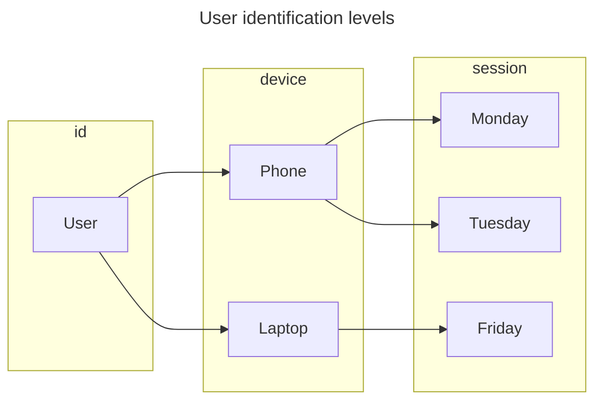

User stitching combines data from multiple sources or sessions into a unified
view of a user. You need it to combine website and mobile app data, to unify
customer interaction data across platforms, or to follow a user's journey
through various touchpoints. It is especially useful when a user interacts with
a system on multiple devices or platforms and these interactions should end up
in a single user profile.

User behavior data is often incomplete, especially on the web, where users can
easily delete cookies, change devices or use a different browser. Stitching
correctly starts with understanding user identification.

Working with persistent identifiers requires the user's consent. Consent is
always bound to specific purposes, which have to be documented and communicated
properly.

:::tip

Learn more about&nbsp;<Link to="/docs/guides/consent">consent management</Link>
with walkerOS.

:::

Relying on third-party tools and cookies might have been common practice, with
benefits, in the past. Data that isn't owned and collected first-party always
depends on others.

First-party data collection is the basis for attribution modeling, a complete
view of your users and data ownership.

## User identification levels

User identification means recognizing a user, typically by associating them
with a unique identifier. walkerOS has three levels of user identification:

- **id**: a unique identifier for a user, typically from internal systems like a
  CRM.
- **device**: a device-specific identifier, saved in the storage.
- **session**: a session-specific identifier for user activities within a single
  session.

A single user can have different devices with multiple sessions. The `id`
identifies an individual user across sessions and devices. The `device`
recognizes a user across multiple sessions on the same device, while `session`
covers user behavior and interactions within one limited time frame.

The diagram represents one user with two devices across three sessions.

:::warning

These techniques may require a user's consent and documentation to respect
privacy and stay compliant. Ask your data protection officer for legal
advice.

:::

## Example

Events are individually measured user interactions. Stitching them together
creates user journeys, and all event-related data helps to identify a user.

The following table is a minified event log over several days. It shows user
activities over time and across sessions, with varying levels of user
identification and consent categories.

All events of a run, representing a page load, share one `source.trace` id. A
`hash` is a temporary fingerprint. `session`, `device`, and `user` are all simplified
unique identifiers.

| Step | Day                 | Event          | Consent   | Trace | Hash | Session | Device | User |
| ---- | ------------------- | -------------- | --------- | ----- | ---- | ------- | ------ | ---- |
| 1    | Monday, 1st    | session start  | analytics | a     | foo  |         |        |      |
| 2    | Monday, 1st    | page view      | analytics | a     | foo  |         |        |      |
| 3    | Monday, 1st    | consent deny   | analytics | a     | foo  |         |        |      |
| 4    | Monday, 1st    | page view      | analytics | b     | foo  |         |        |      |
| 5    | Tuesday, 2nd   | session start  | marketing | c     | bar  | 1       | phone  |      |
| 6    | Tuesday, 2nd   | page view      | marketing | c     | bar  | 1       | phone  |      |
| 7    | Tuesday, 2nd   | consent accept | marketing | c     | bar  | 1       | phone  |      |
| 8    | Tuesday, 2nd   | session start  | marketing | d     | bar  | 2       | phone  |      |
| 9    | Tuesday, 2nd   | page view      | marketing | d     | bar  | 2       | phone  |      |
| 10   | Wednesday, 3rd | session start  | marketing | e     | baz  | 3       | phone  | olli |
| 11   | Wednesday, 3rd | page view      | marketing | e     | baz  | 3       | phone  | olli |
| 12   | Wednesday, 3rd | user login     | marketing | e     | baz  | 3       | phone  | olli |
| 13   | Friday, 5th    | session start  | analytics | f     | qux  |         |        |      |
| 14   | Friday, 5th    | page view      | analytics | f     | qux  |         |        |      |
| 15   | Friday, 5th    | page view      | analytics | g     | qux  |         |        | olli |
| 16   | Friday, 5th    | consent deny   | analytics | g     | qux  |         |        | olli |
| 17   | Friday, 5th    | user login     | analytics | g     | qux  |         |        | olli |
| 18   | Thursday, 11th | session start  | marketing | h     | lol  | 4       | ph0n3  |      |

Based on the data, we can at least summarize the following:

- 18 tracked `events` in total
- 8 different `trace` ids ('a', 'b', 'c', 'd', 'e', 'f', 'g', 'h')
- 6 individual `session start` events
- 5 temporary `hashes` ('foo', 'bar', 'baz', 'qux', 'lol')
- 4 reliable `sessions` (1, 2, 3, 4)
- 2 known `devices` ('phone' and 'ph0n3')
- 1 unique `user` ('olli')
