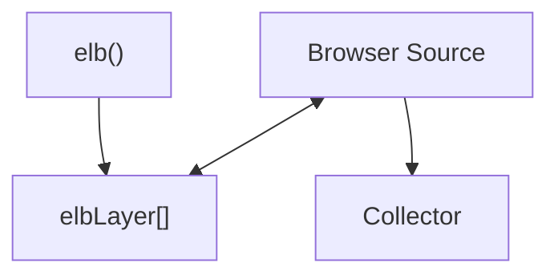

# Browser source commands

The browser source provides an enhanced `elb` function with browser-specific
features: DOM interaction, elbLayer communication and automatic initialization.
The browser source's translation layer processes these commands before it
passes them to the collector.

## elb

The browser source puts its `elb` function on the page. Push an event as a
[partial event](/docs/getting-started/event-model#push-an-event), and a
command by its name:

<CodeSnippet
  code={`elb({ name: 'product add', data: { id: 'P123', price: 29.99 } });
elb('walker consent', { marketing: true });`}
  language="javascript"
/>

During initialization the source installs its writer at `window[settings.elb]`
(default `elb`). The name is a single slot and belongs to the first source that
installs it: a source that finds the name held by another one logs an error,
skips the install, and keeps capturing through its own `push`. Set `elb: false`
to install no window property at all, which suits an embedded source that
should leave no page-window footprint. Calls return a promise that
resolves with the [push result](/docs/getting-started/event-model#push-an-event).

Code that can run before the source starts, such as a page script ahead of an
`async` walker.js, defines this stub first. It queues every call in
`window.elbLayer`, and the source processes the queue once it starts. A queued
call returns nothing; only calls made after the source installed its `elb`
resolve with the push result:

<CodeSnippet
  code={`function elb() {
  (window.elbLayer = window.elbLayer || []).push(arguments);
}`}
  language="javascript"
/>

See
[Multiple sources on one page](/docs/sources/web/browser#multiple-sources-on-one-page)
for running several sources side by side.

### elbLayer processing

`window.elbLayer` is an append-only queue: entries are recorded and never
removed, so inspecting the array always shows the full input history. Both
`window.elb(...)` and `window.elbLayer.push(...)` are processed through the
same translation layer.

Processing order:

* `walker` commands apply as soon as the source is initialized, so a queued
  `walker consent` takes effect before any queued events.
* Events are processed once the source has started (after the first
  `walker run`), in the order they were pushed, and before that run's
  `page view`.
* From then on, all entries are processed strictly in push order.

One named layer belongs to one source, because a queue is drained once. The
first source to adopt `window[settings.elbLayer]` keeps it, and a source that
asks for a name another one already adopted logs an error and runs without a
layer, capturing from its scope as usual. Parallel flows use separate layer
names or `elbLayer: false`.

## config

Configure the browser source during initialization through `startFlow`. These
settings control browser-specific behavior:

<CodeSnippet
  code={`import { startFlow } from '@walkeros/collector';
import { sourceBrowser } from '@walkeros/web-source-browser';

const { collector } = await startFlow({
  sources: {
    browser: {
      code: sourceBrowser,
      config: {
        settings: {
          elb: 'elb', // Name for the global elb function, or false to install none
          elbLayer: true, // Enable elbLayer for async command queuing
          pageview: true, // Trigger a page view event by default
          prefix: 'data-elb', // Attributes prefix used by the walker for DOM scanning
        },
      },
    },
  },
});`}
  language="javascript"
/>

:::note

Browser source configuration must be done during initialization.
Settings like `prefix` and `elbLayer` cannot be changed after the source is
created. Session tracking is provided by the separate
`@walkeros/web-source-session` source.

:::

## run

`startFlow` sends the first run unless it is called with `run: false`, and each
`walker run` starts a new one. On such a run the browser source:

* Scans its scope for `data-elb` attributes, wires the triggers they declare
  and fires the `load` triggers
* Processes the events queued in `elbLayer` (on the first run)
* Reads `data-elbuser` into the user
* Sends a `page view` (unless `pageview` is `false`)

<CodeSnippet
  code={`elb('walker run');`}
  language="javascript"
/>

With `history` on, the source also starts a run on every route change. That run
sends the `page view` but does not re-scan: it keeps the registered elements,
and the route's new elements register as they render (see
[single-page apps](/docs/sources/web/browser/#single-page-apps)).

The state a run accepts, and the queued events it discards, are described under
[walker run](/docs/collector/commands#run-command).

### Virtual pageviews in SPAs

Each `walker run` sends a new `page view` and re-scans the DOM, which is how a
single-page app counts a route change by hand. Route changes do not start a new
session: the session source detects a session start once per page load.

:::note

With the `history` setting on, the browser source follows route changes by
itself, and walker.js has it on. Do not also call `walker run` per route change,
or every navigation sends two page views. See
[single-page apps](/docs/sources/web/browser/#single-page-apps).

:::

With `history: false`, call `walker run` from the router's post-render hook,
listed per router under
[single-page apps](/docs/sources/web/browser/#single-page-apps). Skip the call
for the first render: the run that started the flow already sent the landing
page's `page view`.

## init

Re-initializes event listeners on one or multiple target elements without
triggering a page view. Useful for dynamically loaded content like product
lists, infinite scroll, or wizard steps.

<CodeSnippet
  code={`elb('walker init', element); // Single element
elb('walker init', [element1, element2]); // Multiple elements`}
  language="javascript"
/>

Single-page apps (SPAs) use it for content added dynamically after the initial
page load.

Re-initializing a scope clears and rebuilds that scope's `pulse`, `wait`,
`hover`, `scroll`, `visible`, and `impression` triggers. The `load` trigger fires (again) on each call.

This applies to every action-tagged element in the target's subtree, including
elements that are already tracked from an earlier scan. So the SPA pattern of
re-tagging an existing element and re-initializing it works: the updated
attribute values are read fresh and the `load` trigger fires again.

<CodeSnippet
  code={`// The step element was already tracked by the initial page scan.
const step = document.getElementById('checkout-step');
step.setAttribute('data-elb-checkout', 'step:3');
elb('walker init', step); // fires 'checkout start' again, now with step: 3`}
  language="javascript"
/>

Each `walker run` does the same for the whole document, so a virtual pageview
also re-fires document `load` triggers.

<CodeSnippet
  code={`// After loading new products via AJAX
const productList = document.getElementById('product-list');
fetchProducts().then(() => {
  elb('walker init', productList);
});`}
  language="javascript"
/>

:::tip

Use `walker init` after adding new DOM elements with `data-elb` attributes.
Unlike `walker run`, it does not trigger a page view event; it only enables
tracking on the specified elements.

:::

For content that a SPA injects repeatedly into the same container, the
[`data-elbobserve`](/docs/sources/web/browser/tagging/html-attributes#auto-init-with-data-elbobserve)
attribute is a declarative alternative: mark the container once and injected
tagged content is registered automatically, without a `walker init` call after
each injection.

## run vs init comparison

| Command | Triggers pageview | Re-scans DOM | Use case |
|---------|------------------|--------------|----------|
| `walker run` | Yes | Full page | SPA route changes with `history: false`, virtual pageviews |
| `walker init` | No | Target elements only | Dynamically loaded content (product lists, infinite scroll) |

## Integration with collector

Browser source commands work together
with <Link to="/docs/collector/commands">collector commands</Link>: the
browser source handles DOM-specific functionality, and the collector manages
destinations, consent, and user data.

Common workflow:

1. Configure browser source in `startFlow`
2. Browser source automatically initializes (or use `walker run` for manual
   control)
3. Use `walker init` for dynamic content
