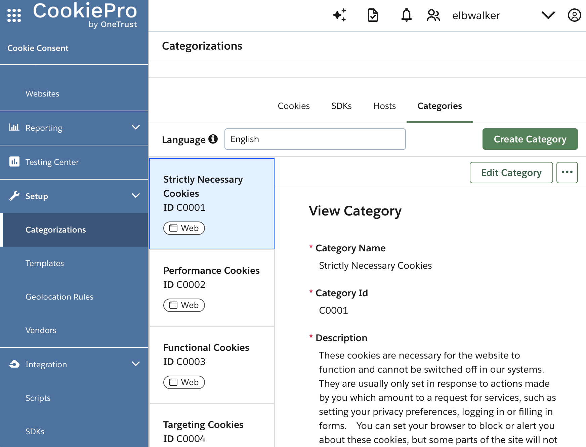

import data from '@walkeros/web-source-cmp-cookiepro/walkerOS.json';
import Configuration from '@site/src/components/snippets/_configuration.mdx';

# CookiePro / OneTrust

Integrates [CookiePro / OneTrust](https://www.onetrust.com/) consent management with walkerOS by mapping CookiePro category IDs (`C0001`, `C0002`, ...) to walkerOS consent groups.

## Installation

```bash
npm install @walkeros/web-source-cmp-cookiepro
```

```typescript
import { startFlow } from '@walkeros/collector';
import { sourceCookiePro } from '@walkeros/web-source-cmp-cookiepro';

await startFlow({
  sources: {
    consent: {
      code: sourceCookiePro,
    },
  },
});
```

<Configuration type="source" data={data} />

## How it works

1. **Already loaded**: Checks if `window.OneTrust` and
   `window.OptanonActiveGroups` already exist. If so, processes consent
   immediately.

2. **OptanonWrapper**: If the SDK isn't loaded yet, wraps the global
   `OptanonWrapper` callback (preserving any existing wrapper). The wrapper
   self-unwraps after the first call.

3. **OneTrustGroupsUpdated event**: Listens for the `OneTrustGroupsUpdated`
   window event and re-reads `OptanonActiveGroups` each time it fires.

4. **Parsing**: Splits the `OptanonActiveGroups` comma-separated string, maps
   category IDs through `categoryMap`, and calls `elb('walker consent', state)`.
   Sets explicit `false` for all mapped groups not in the active list.

### CookiePro categories

CookiePro registers cookies and assigns them to categories. Those categories are
mapped to walkerOS consent groups:



### Default category mapping

```typescript
{
  C0001: 'necessary',   // Strictly Necessary
  C0002: 'analytics',   // Performance
  C0003: 'functional',  // Functional
  C0004: 'marketing',   // Targeting
  C0005: 'social',      // Social Media
}
```

Category ID comparison is case-insensitive. Unmapped category IDs are ignored
since CookiePro's opaque IDs are meaningless without a mapping. All mapped
walkerOS groups receive explicit `true`/`false` values. Absent groups are set
to `false` so destinations know which consent is denied.

Strictly necessary cookies need no consent, so `C0001` grants no consent group
and is reported as `necessary`. `functional` follows the visitor's choice for
`C0003` (Functional) and `marketing` the one for `C0004` (Targeting). Social
media cookies (`C0005`) get their own `social` group.

When several category IDs map to the same group, the group is `true` only if
every one of them is active: any deny denies. Map only IDs your banner uses: an
ID OneTrust never lists keeps its group denied.

Custom entries are merged with the default mapping. Specify only the categories
you want to override. All other defaults remain active.

### Custom mapping example

```typescript
await startFlow({
  sources: {
    consent: {
      code: sourceCookiePro,
      config: {
        settings: {
          categoryMap: {
            C0002: 'statistics', // Use 'statistics' instead of 'analytics'
          },
          explicitOnly: true,
        },
      },
    },
  },
});
```

### Timing considerations

The source handles these cases:

- **SDK loads before source**: The "already loaded" check reads existing consent
  from `OptanonActiveGroups` immediately.
- **Source loads before SDK**: The `OptanonWrapper` wrapping intercepts the
  SDK's init callback.
- **`explicitOnly` (default)**: Uses `OneTrust.IsAlertBoxClosed()` to determine
  if the user has actively interacted with the consent banner. Until the banner
  is closed the source sends no consent, so for a visitor who never closes it,
  destinations gated with `config.consent` never send events (see
  [how CMP sources work](/docs/sources/web/cmps#how-cmp-sources-work)).

## Reference

- [OneTrust SDK documentation](https://my.onetrust.com/s/article/UUID-66bcaaf1-c7ca-5f32-6760-c75a1337c226)
- [Source code](https://github.com/elbwalker/walkerOS/tree/main/packages/web/sources/cmps/cookiepro)
